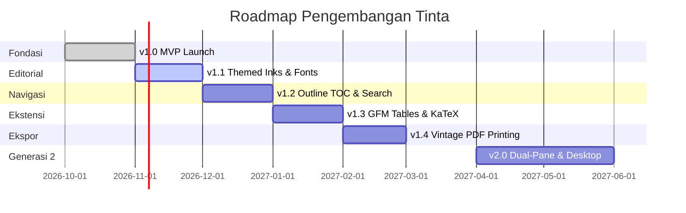

# 📜 Strategi Open-Source & Roadmap Evolusi Tinta

Dokumen ini mengupas tuntas strategi positioning, pemilihan lisensi, tahapan rilis, dan peta jalan fitur jangka panjang untuk menjadikan **Tinta** salah satu proyek open-source Android pembaca Markdown paling diminati.

---

## 1. Positioning & Nilai Pembeda (The "Hook")

Di dunia open-source, terdapat ratusan aplikasi catatan atau pembaca teks. Mengapa orang akan tertarik menggunakan dan meng-upgrade Tinta?

```
┌────────────────────────────────────────────────────────────────────────┐
│                        DILEMA APLIKASI SAAT INI                        │
├───────────────────────────────────┬────────────────────────────────────┤
│   Aplikasi Pembaca Teks Biasa     │       Aplikasi Editor Kompleks     │
│  - Tampilan serba datar & dingin  │  - Fitur terlalu banyak (bloated)  │
│  - Kontras hitam-putih bikin lelah│  - Wajib registrasi / cloud login  │
│  - Blok kode monoton              │  - Meminta banyak izin perangkat   │
└───────────────────────────────────┴────────────────────────────────────┘
                                    │
                                    ▼
┌────────────────────────────────────────────────────────────────────────┐
│                        POSISI UNIK: "TINTA"                            │
│  ✓ Estetika Kertas Koran Hangat (Warm Parchment) & Serif Elegan       │
│  ✓ 100% Offline (Zero Network Permissions, Privasi Absolut)           │
│  ✓ Cepat, Ringan & Berbasis Storage Access Framework (SAF) Asli        │
│  ✓ Dioptimalkan membaca draf teknis, PRD, dan hasil keluaran AI       │
└────────────────────────────────────────────────────────────────────────┘
```

### Daya Tarik bagi Komunitas:
1. **AI Prompt Engineers & Developers**: Sering membaca dokumen berformat panjang (seperti file PRD, log analisis agen AI, dokumen RFC arsitektur). Membaca di atas warna koran hangat jauh lebih ramah di mata dibandingkan tema gelap kontras tinggi (*cold dark mode*).
2. **Penggemar Privasi (Privacy Purists)**: Tidak ada koneksi internet, tidak ada pelacakan analitik Google, dan tidak ada server luar.

---

## 2. Analisis & Pemilihan Lisensi Open-Source

Proyek open-source memerlukan lisensi hukum yang jelas agar kontributor dan pengguna memahami hak dan batasannya. Berikut perbandingannya:

| Jenis Lisensi | Sifat | Kelebihan | Kekurangan | Cocok Untuk |
| :--- | :--- | :--- | :--- | :--- |
| **Apache 2.0** *(Dipilih untuk Tinta)* | Permisif Berimbang | Melindungi paten pencipta, memberikan kebebasan pakai/modifikasi luas, standar industri Android (dipakai AOSP & Jetpack). | Sedikit lebih panjang dari teks lisensi MIT. | Aplikasi Android modern & portofolio profesional. |
| **MIT** | Sangat Permisif | Sangat pendek dan sederhana, siapa saja bebas melakukan apa saja. | Tidak mencantumkan klausul perlindungan sengketa paten secara eksplisit. | Library kecil atau utility script. |
| **GPL-3.0** | Copyleft Kuat | Memaksa siapapun yang menggunakan/memodifikasi kode untuk membuka kodenya juga (anti-komersialisasi tertutup). | Dapat membatasi integrasi dengan library non-GPL. | Aplikasi sistem privasi ekstrim (seperti *NewPipe*). |

> **Keputusan:** Tinta menggunakan **Apache License 2.0**. Lisensi ini memberi rasa aman bagi Anda sebagai pemilik hak cipta, ramah bagi pengembang lain untuk berkontribusi, dan diakui secara luas oleh ekosistem Android profesional.

---

## 3. Roadmap Evolusi Fitur (v1.0 – v2.0)

Untuk menjaga repositori tetap aktif dan mendapatkan momentum di GitHub, pembaruan fitur sebaiknya dirilis secara bertahap (*milestone release*):



### Rincian Setiap Versi:

#### 🟢 Versi 1.0 — "The MVP Gazette" (Status: Selesai)
* Pembacaan berkas Markdown `.md` dan `.txt` lokal via SAF.
* Persistensi izin berkas (`takePersistableUriPermission`).
* Dasbor *The Archives* dengan kartu kliping riwayat baca.
* Blok kode bergaya mesin tik dengan tombol salin instan (*one-tap copy*).
* Zero-Network permissions di `AndroidManifest.xml`.

#### 🟡 Versi 1.1 — "The Editorial Studio" (Target Selanjutnya)
* **Theme Tint Switcher**:
  * *Morning Gazette* (Kertas koran terang - `#F7F4EB`).
  * *Aged Parchment* (Kertas perkamen antik - `#EFE8D8`).
  * *Midnight Sepia* (Tema gelap bernuansa tinta cumi kuno - `#1A1816`).
* **Typographic Control**: Slider pengatur ukuran teks baca (14sp – 24sp) dan pemilihan font family (*Playfair Serif*, *Merriweather*, *JetBrains Sans*, *Courier Monospace*).
* **Reading Progress Bar**: Garis tipis penunjuk progres scroll di bagian atas layar.

#### 🔵 Versi 1.2 — "The Scholar's Desk"
* **Table of Contents (TOC) Drawer**: Tombol daftar isi yang memunculkan panel heading (H1, H2, H3) sehingga pembaca bisa loncat langsung ke bab tertentu.
* **In-Document Search**: Pencarian kata cepat (*Find in text*) dengan penyorotan warna tinta (*ink highlight*).

#### 🟣 Versi 1.3 — "Extended Typesetting"
* **GFM Table Support**: Perenderan tabel Markdown (`| Header |`) dengan garis kisi koran klasik yang rapi.
* **Task Checklist**: Kotak centang interaktif bergaya cap cetak (`- [x] Done`).
* **Offline LaTeX Preview**: Rumus matematika dan formula teknis tanpa koneksi CDN luar.

#### 🔴 Versi 1.4 — "The Printing Press Export"
* **Export to Vintage PDF**: Mengubah berkas Markdown menjadi dokumen PDF berestetika koran fisik 2-kolom yang siap cetak atau dibagikan ke orang lain.

---

## 4. Monetisasi Etis & Apresiasi Proyek Open-Source

Proyek personal open-source dapat menghasilkan apresiasi finansial tanpa merusak integritas kode:

1. **GitHub Sponsors**: Memasang tombol sponsor di GitHub repositori. Para pengguna atau developer yang menyukai Tinta dapat memberikan tip bulanan ($1 - $5/bulan).
2. **Buy Me a Coffee / Ko-fi / Saweria**: Tautan donasi sederhana yang dicantumkan di bagian bawah `README.md`.
3. **Showcase Portfolio**: Nilai terbesar proyek ini bagi Anda adalah **reputasi profesional**. Menampilkan Tinta di CV atau profil LinkedIn sebagai aplikasi Android open-source dengan arsitektur bersih, CI/CD otomatis, dan ratusan bintang di GitHub akan bernilai jauh lebih tinggi bagi peluang karir software engineering.
