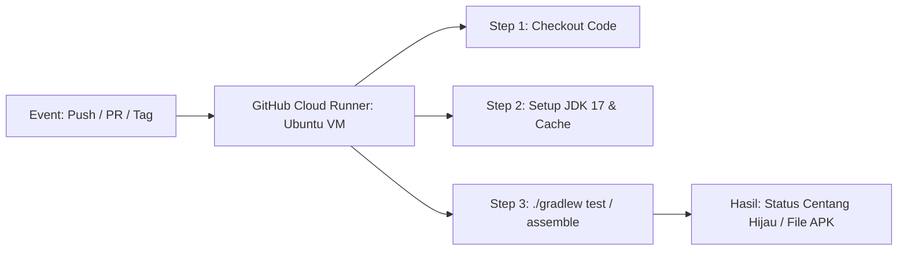

# ⚙️ Panduan GitHub Actions CI/CD Pipeline

Dokumen ini menjelaskan arsitektur otomasi pengujian dan perilisan aplikasi Tinta menggunakan **GitHub Actions**.

---

## 1. Konsep Dasar GitHub Actions

GitHub Actions adalah layanan komputasi awan (*cloud runner*) gratis yang disediakan GitHub untuk menjalankan alur kerja otomatis (CI/CD) setiap kali terjadi peristiwa (*event*) tertentu pada repositori Anda.



---

## 2. Bedah Workflow 1: `ci.yml` (Continuous Integration)

File lokasi: [ci.yml](file:///d:/TelyuTask/01_Akademik_Semester/semester_5/Tinta/.github/workflows/ci.yml)

### Kapan Dijalankan?
* Setiap kali ada kode baru yang di-*push* ke branch `master` atau `main`.
* Setiap kali ada orang yang membuat **Pull Request (PR)** ke repositori Anda.
* Dapat juga dipicu manual lewat menu tab *Actions* di GitHub (`workflow_dispatch`).

### Analisis Baris Kunci:
```yaml
- name: Set up JDK 17
  uses: actions/setup-java@v4
  with:
    distribution: 'zulu'
    java-version: '17'
    cache: 'gradle' # ⚡ Otomatis menyimpan cache dependencies Gradle
```
* **Cache Gradle**: Tanpa cache, runner harus mengunduh ulang ratusan megabyte library setiap kali tes berjalan (memakan waktu 5-7 menit). Dengan cache, waktu build berkurang drastis menjadi hanya ~1-2 menit.

```yaml
- name: Run Unit Tests
  run: ./gradlew testDebugUnitTest --no-daemon --stacktrace
```
* Menjalankan seluruh unit test lokal (seperti verifikasi sanitasi judul dokumen, pemotongan kutipan, dan deteksi berkas biner pada `DocumentArchiveTest.kt`).
* Jika ada 1 tes saja yang gagal, proses build langsung dihentikan dan PR ditandai tanda silang merah ❌.

---

## 3. Bedah Workflow 2: `release.yml` (Automated APK Publishing)

File lokasi: [release.yml](file:///d:/TelyuTask/01_Akademik_Semester/semester_5/Tinta/.github/workflows/release.yml)

### Kapan Dijalankan?
* Saat Anda membuat Git Tag yang diawali huruf `v` (contoh: `v1.0.0`, `v1.1.0`).
* Atau dipicu manual melalui tombol *"Run workflow"* di tab Actions GitHub.

### Alur Kerja Penandatanganan Otomatis (*Auto-Signing*):
1. **Compile**: Menjalankan `./gradlew assembleRelease assembleDebug`.
2. **Auto-Sign**: File rilis bawaan Gradle (`app-release-unsigned.apk`) belum memiliki tanda tangan digital sehingga HP Android akan menolaknya saat diinstall. Runner cloud secara otomatis membuat sertifikat *self-signed keystore* sementara dan menandatanganinya dengan utilitas `jarsigner`.
3. **Penamaan Rapi**: File APK diubah namanya menjadi:
   * `Tinta-v1.0.0.apk` (Versi rilis resmi).
   * `Tinta-v1.0.0-debug.apk` (Versi debug untuk pengujian pengembang).
4. **Publish Release**: Menggunakan aksi resmi `softprops/action-gh-release@v2` untuk membuat draf rilis GitHub, menyematkan deskripsi otomatis dari commit terakhir, dan mengunggah kedua file `.apk` ke halaman publik.

---

## 4. Cara Menjalankan Rilis Baru (Langkah Praktis)

Hanya dengan 2 perintah git di terminal laptop Anda:

```bash
# 1. Pastikan semua perubahan sudah di-commit
git add .
git commit -m "feat: release version 1.0.0"
git push origin master

# 2. Buat tag dan kirim ke GitHub
git tag v1.0.0
git push origin v1.0.0
```

Setelah perintah di atas dikirim, buka tab **Actions** di browser Anda. Anda akan melihat animasi proses build berjalan, dan dalam waktu sekitar 3 menit, file APK Anda sudah terbit di halaman **Releases**!
