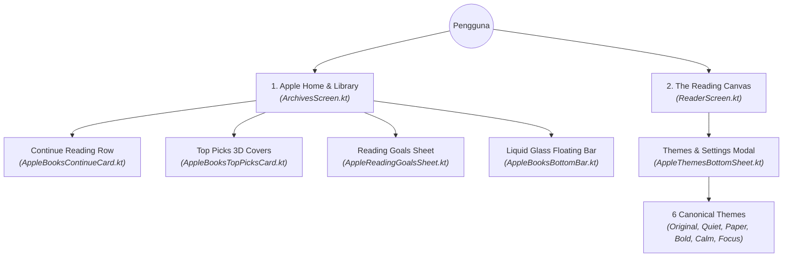

# 🍏 Transformasi Desain: "Apple Books Experience" untuk Markdown Reader

Dokumen ini membedah secara rinci perombakan besar antarmuka (UI/UX) **Tinta** yang mengadopsi standar desain **Apple Books** ke dalam ekosistem Android menggunakan **Jetpack Compose**.

---

## 1. Filosofi & Visi: "Apple Books Wannabe for Markdown"

Aplikasi pembaca Markdown biasa di Android umumnya kaku, bernuansa teknikal dingin (*cold developer tool*), dan minim rasa taktil buku fisik. 

Dengan inspirasi langsung dari **Apple Books iOS**:
1. Berkas `.md` dan `.txt` tidak lagi diperlakukan sebagai "file komputer biasa", melainkan sebagai **buku/kliping editorial bernilai tinggi**.
2. Pembaca diberikan kendali penuh atas kenyamanan mata mereka melalui modal **Themes & Settings** yang taktil.
3. Repositori kode dipisahkan ke branch khusus: `feature/apple-books-ui` agar branch `master` tetap aman dan stabil.

---

## 2. Bedah 4 Layar Utama & Implementasi Jetpack Compose



---

### A. Layar 1: Apple Books "Home" & Library (`ArchivesScreen.kt`)
* **Header Elegan**: Judul besar "Home" dalam font Serif berbobot, dilengkapi **Reading Goal Ring** sirkular di pojok kanan atas (lingkaran progress cyan dengan angka target selesai) dan ikon profil pembaca.
* **Bagian "Continue"**: Deretan horizontal (*carousel*) dokumen yang sedang aktif dibaca dengan kartu *dark slate* membulat (`RoundedCornerShape(18.dp)`), thumbnail sampul buku bergradien 3D, judul, estimasi waktu baca, progress bar, dan tombol menu `...`.
* **Bagian "Top Picks"**: Kartu etalase putih dengan sampul buku 3D yang tampak berdiri tegak (*standing book covers with drop shadows*), memberikan kesan perpustakaan fisik.
* **Bagian "All Dispatches"**: Grid rak buku untuk seluruh koleksi Markdown lokal.

---

### B. Layar 2: "Themes & Settings" Bottom Sheet (`AppleThemesBottomSheet.kt`)
Tepat seperti tampilan Apple Books di iPhone saat membaca:
1. **Stepper Ukuran Font `[ A | A ]`**: Kapsul tombol tersegmentasi di mana sisi kiri memperkecil huruf (*small A*) dan sisi kanan memperbesar huruf (*large A*).
2. **Slider Kecerahan & Kehangatan Lampu**: Slider mulus dengan ikon matahari kecil di kiri dan matahari besar di kanan.
3. **Grid 6 Kartu Tema Resmi Apple Books**:
   * **Original**: Kanvas putih bersih (`#FFFFFF`) dengan tinta hitam tajam.
   * **Quiet**: Tema gelap arang (`#1C1C1E`) yang sangat nyaman untuk membaca tengah malam.
   * **Paper**: Kertas cetak alami bertekstur koran klasik (`#F8F5EE`).
   * **Bold**: Tipografi berbobot ekstra untuk meningkatkan kontras teks.
   * **Calm**: Warna krem perkamen hangat (*Warm Tan* `#EFE8D8`) — tema signature Apple Books dengan bingkai hitam solid saat aktif terpilih!
   * **Focus**: Nuansa krem lemon lembut (`#FAF6EE`) untuk konsentrasi membaca panjang.
4. **Tombol "⚙ Customize"**: Kapsul di bagian bawah yang dapat diperluas untuk memilih keluarga font (*New York Serif, San Francisco Sans, Typewriter Mono*) dan jarak antar-baris (*Line Spacing: Compact, Standard, Relaxed*).

---

### C. Layar 3: Bilah Navigasi Mengambang (*Floating Liquid Glass Bar*)
Berdasarkan panduan resmi Apple **Human Interface Guidelines (HIG)**:
* Navigasi tidak menempel mati di tepi bawah layar, melainkan **mengambang (*floating pill*)** dengan sudut melengkung 32dp dan bayangan lembut.
* Memiliki 4 tab utama:
  1. 🏠 **Home** (Beranda baca & recent)
  2. 📚 **Library** (Koleksi berkas & tombol impor SAF)
  3. ⏱️ **Goals** (Target & statistik membaca)
  4. 🔍 **Search** (Pencarian instan judul dan isi Markdown)

---

### D. Layar 4: Modal Target Membaca (*Reading Goals Sheet*)
* Dibuka langsung dari cincin target di Home atau tab Goals.
* Menampilkan rak visual buku yang telah dibaca lengkap dengan **lencana centang biru (*blue checkmark badges*)**.
* Judul besar: *"Book time for yourself with Reading Goals."*
* Teks statistik: *"Dispatches Read This Month • X dispatches finished."*
* Tombol aksi pil hitam: **`SHARE`** dan tombol teks **`ADJUST GOAL`**.

---

## 3. Struktur File Baru pada Branch `feature/apple-books-ui`

```
app/src/main/java/com/zeeonworks/tinta/
├── ui/
│   ├── theme/
│   │   └── AppleBooksTheme.kt             // 6 Preset tema, warna, & typography provider
│   ├── reader/
│   │   ├── ReaderScreen.kt                // Layar baca Apple Books responsif
│   │   └── components/
│   │       ├── AppleThemesBottomSheet.kt  // Sheet 6 tema & stepper font [ A | A ]
│   │       └── MarkdownRenderer.kt        // Perender AST Markdown reaktif ke tema
│   └── archives/
│       ├── ArchivesScreen.kt              // Home & Library multi-tab Apple Books
│       └── components/
│           ├── AppleBooksBottomBar.kt     // Floating liquid glass pill bar
│           ├── AppleBooksContinueCard.kt  // Kartu Continue reading dark slate
│           ├── AppleBooksTopPicksCard.kt  // Kartu etalase buku 3D Top Picks
│           ├── AppleBooksBookCard.kt      // Kartu buku perpustakaan vertikal
│           └── AppleReadingGoalsSheet.kt  // Modal target baca & badge centang biru
```
