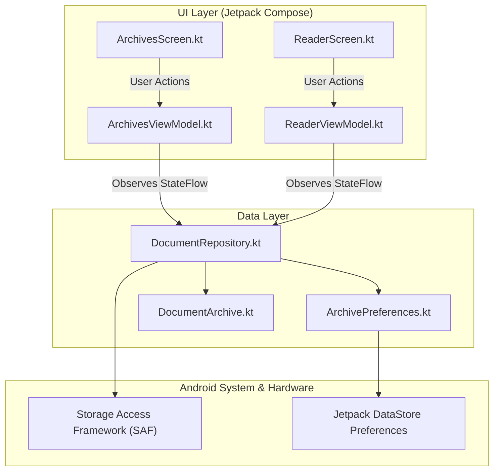

# 🏛️ Bedah Arsitektur: Clean Architecture, MVVM & SAF

Dokumen ini membedah arsitektur internal aplikasi **Tinta**, mulai dari pemisahan lapisan kode (*layering*), alur data satu arah (*Unidirectional Data Flow*), hingga integrasi *Storage Access Framework (SAF)*.

---

## 1. Pemisahan Lapisan (Clean Architecture Layers)

Aplikasi Tinta dibangun dengan memisahkan logika bisnis, penyimpanan data, dan antarmuka pengguna secara tegas:



---

## 2. Alur Data Satu Arah (Unidirectional Data Flow — UDF)

Di Jetpack Compose, state (data antarmuka) mengalir ke bawah (*State Flows Down*), sementara event (aksi tombol / klik pengguna) mengalir ke atas (*Events Flow Up*):

```
┌────────────────────────────────────────────────────────┐
│                   UNIDIRECTIONAL DATA FLOW             │
├────────────────────────────────────────────────────────┤
│                     [ ArchivesScreen ]                 │
│                        │         ▲                     │
│   (User klik tombol '+')│         │ (State: List Arsip) │
│                        ▼         │                     │
│                  [ ArchivesViewModel ]                 │
│                        │         ▲                     │
│    (Panggil repo.open) │         │ (Flow<List<Archive>)│
│                        ▼         │                     │
│                 [ DocumentRepository ]                 │
└────────────────────────────────────────────────────────┘
```

### Mengapa Pola Ini Penting?
1. **Tidak Ada State Duplikat**: Sumber kebenaran tunggal (*Single Source of Truth*) dipegang oleh ViewModel via `StateFlow`. UI hanya bertugas menampilkan state tersebut.
2. **Mudah Diuji (*Testable*)**: Kita bisa menulis unit test untuk menguji ViewModel dan Repository tanpa perlu menyalakan emulator Android fisik.

---

## 3. Storage Access Framework (SAF) & Persistable URI

Pada Android versi modern (Android 10+ / Scoped Storage), aplikasi dilarang membaca berkas di memori HP secara sembarangan menggunakan path biasa seperti `/sdcard/Download/catatan.md`.

Tinta menggunakan **Storage Access Framework (SAF)** resmi melalui kontrak:
```kotlin
val openDocumentLauncher = rememberLauncherForActivityResult(
    contract = ActivityResultContracts.OpenDocument()
) { uri ->
    uri?.let { viewModel.onDocumentPicked(it) }
}
```

### Persistensi Hak Akses (`takePersistableUriPermission`):
Secara bawaan Android, hak akses `Uri` yang dipilih pengguna akan **hangus** begitu aplikasi ditutup atau HP di-restart. Untuk mencegah pengguna harus memilih berkas berulang kali, Tinta memanggil:
```kotlin
context.contentResolver.takePersistableUriPermission(
    uri,
    Intent.FLAG_GRANT_READ_URI_PERMISSION
)
```
Dengan baris ini, sistem Android mencatat izin permanen sehingga berkas di daftar *The Archives* dapat langsung dibuka kembali kapan saja!

---

## 4. Penyimpanan DataStore & Kotlinx Serialization

Riwayat metadata dokumen disimpan di Jetpack DataStore dalam bentuk serialized JSON list:

```kotlin
@Serializable
data class DocumentArchive(
    val uriString: String,
    val title: String,
    val lastOpenedEpoch: Long,
    val wordCount: Int,
    val snippet: String
)
```

DataStore beroperasi secara asinkron (*asynchronous*) menggunakan Kotlin Coroutines Flow di background thread (`Dispatchers.IO`), sehingga tidak pernah membekukan (*freeze*) layar utama aplikasi.
