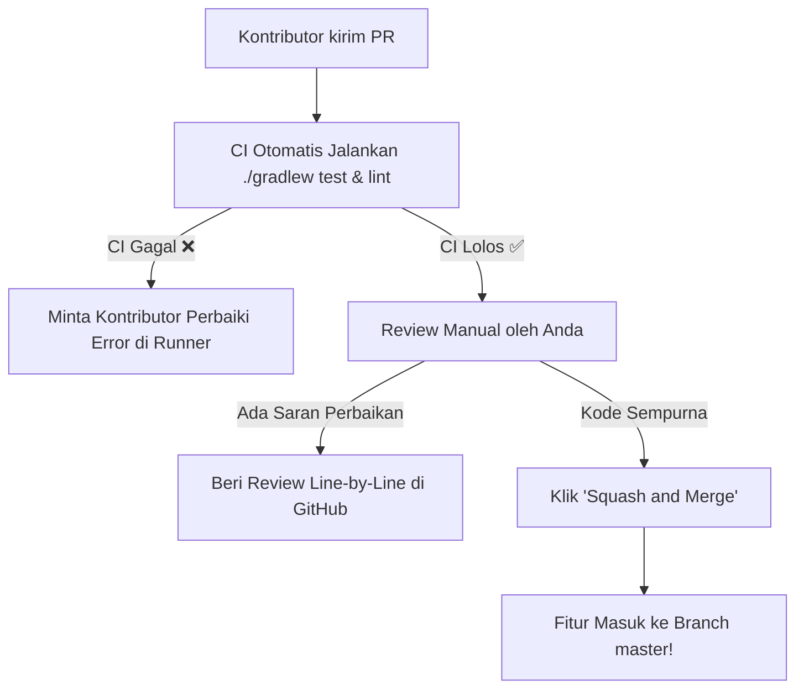

# 👑 Panduan Menjadi Maintainer Open-Source Profesional

Dokumen ini memandu Anda dalam menjalankan peran sebagai **Pemilik Proyek & Maintainer Utama (*Lead Maintainer*)** Tinta: cara mengelola kontribusi orang lain, menetapkan nomor versi, hingga menulis catatan rilis yang menarik.

---

## 1. Aturan Semantic Versioning (SemVer 2.0.0)

Semua rilis Tinta menggunakan format nomor versi resmi: `vMAJOR.MINOR.PATCH` (contoh: `v1.0.0`).

```
          v 1 . 2 . 1
            │   │   └── PATCH : Perbaikan bug kecil tanpa fitur baru
            │   └────── MINOR : Penambahan fitur baru (masih kompatibel)
            └────────── MAJOR : Perubahan besar / perombakan arsitektur
```

* **Naikkan PATCH (v1.0.1)**: Saat memperbaiki bug render teks, mengatasi crash pada HP tertentu, atau merapikan typo.
* **Naikkan MINOR (v1.1.0)**: Saat menambahkan fitur baru yang kompatibel, misalnya: menambahkan *Theme Tint Switcher*, *Table of Contents*, atau dukungan tabel GFM.
* **Naikkan MAJOR (v2.0.0)**: Saat melakukan perombakan besar, misalnya: migrasi total arsitektur ke Kotlin Multiplatform (Android + Desktop).

---

## 2. Alur Pengelolaan Pull Request (PR Review Flow)

Ketika ada pengembang dari belahan dunia lain yang mengirimkan kode (Pull Request) ke repo Tinta:



### Tips Review Kode:
1. **Periksa Izin Jaringan**: Pastikan PR tersebut **TIDAK** menambahkan izin `android.permission.INTERNET` di `AndroidManifest.xml`.
2. **Periksa Konsistensi Tema**: Pastikan warna atau style baru mengambil token dari `TintaTheme` bukan hardcoded HEX baru.
3. **Gunakan Opsi 'Squash and Merge'**: Menggabungkan banyak commit kecil kontributor menjadi 1 commit rapi di branch utama Anda.

---

## 3. Labeling & Strategi "Good First Issue"

Untuk menarik lebih banyak kontributor pemula ke repositori Anda:
* Beri label **`good first issue`** pada tugas-tugas ringan, contohnya:
  * Menambahkan terjemahan bahasa baru (Indonesia, Spanyol, Jepang).
  * Menambahkan palet warna tema baru di `Color.kt`.
  * Memperbaiki dokumentasi atau menambahkan contoh file markdown.
* Kontributor pemula di GitHub sering mencari repositori dengan label ini untuk mulai belajar open-source!

---

## 4. Format Catatan Rilis yang Menarik (Release Notes)

Setiap kali Anda menerbitkan versi baru di GitHub Releases, sertakan format changelog seperti ini:

```markdown
## 📰 What's New in Tinta v1.1.0

### ✨ New Features
* Added **Aged Parchment** and **Midnight Sepia** paper tints for night reading.
* Introduced dynamic **Table of Contents (TOC)** drawer for instant heading navigation.

### 🐛 Bug Fixes
* Resolved memory issue when opening markdown dispatches exceeding 50,000 words.
* Fixed text clipping on devices with high display scaling.

### 🤝 Contributors
Special thanks to @contributor1 and @contributor2 for their contributions!

**Full Changelog**: https://github.com/mzhafraan/Tinta-md-reader/compare/v1.0.0...v1.1.0
```
