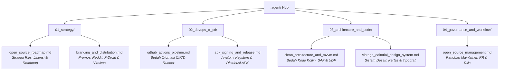

# 📚 Tinta Knowledge & Learning Archive (`.agent/`)

Selamat datang di pusat dokumentasi dan basis pengetahuan proyek **Tinta**!

Folder `.agent/` ini disusun khusus sebagai modul pembelajaran komprehensif bagi Anda. Di sini, seluruh strategi, arsitektur, proses DevOps CI/CD, hingga panduan pengelolaan proyek open-source didokumentasikan secara rinci, terstruktur, dan ramah pembaca.

---

## 🧭 Peta Navigasi Materi Pembelajaran

---

## 📑 Daftar Isi & Ringkasan Modul

### 📁 [01. Strategi & Positioning Produk](01_strategy/)
1. **[open_source_roadmap.md](01_strategy/open_source_roadmap.md)**
   * Mengapa proyek open-source membutuhkan *niche* kuat?
   * Perbandingan lisensi: *Apache 2.0 vs MIT vs GPLv3*.
   * Rencana evolusi fitur dari versi v1.0 hingga v2.0.
   * Model pendanaan etis (GitHub Sponsors, Ko-fi).
2. **[branding_and_distribution.md](01_strategy/branding_and_distribution.md)**
   * Strategi menembus katalog **F-Droid** dan **IzzyOnDroid**.
   * Cara membuat postingan promosi yang disukai di Reddit (`r/androiddev`, `r/opensource`) dan Hacker News tanpa terkesan *spam*.
   * Memaksimalkan visual repositori agar viral di GitHub Trending.

---

### 📁 [02. DevOps, CI/CD & Rilis APK](02_devops_ci_cd/)
1. **[github_actions_pipeline.md](02_devops_ci_cd/github_actions_pipeline.md)**
   * Memahami cara kerja runner cloud GitHub Actions.
   * Penjelasan baris demi baris file workflow `ci.yml` dan `release.yml`.
   * Teknik *caching* dependensi Gradle untuk mempercepat build time hingga 70%.
2. **[apk_signing_and_release.md](02_devops_ci_cd/apk_signing_and_release.md)**
   * Mengapa file `.apk` harus di-sign sebelum bisa dipasang di HP Android?
   * Anatomi sertifikat Keystore (RSA, SHA-256, validity).
   * Cara membagikan rilis langsung ke pengguna tanpa membayar akun Google Play Developer $25.

---

### 📁 [03. Arsitektur Teknis & Kode Kotlin](03_architecture_and_code/)
1. **[clean_architecture_and_mvvm.md](03_architecture_and_code/clean_architecture_and_mvvm.md)**
   * Bedah arsitektur Clean Architecture + MVVM pada Tinta.
   * Alur Unidirectional Data Flow (UDF) dari View -> ViewModel -> Repository.
   * Cara kerja Storage Access Framework (SAF) dan persistensi hak akses (`takePersistableUriPermission`).
   * Serialisasi JSON preferensi DataStore dengan Kotlinx Serialization.
2. **[vintage_editorial_design_system.md](03_architecture_and_code/vintage_editorial_design_system.md)**
   * Konsep estetika *Warm Parchment* vs *Cold Dark Mode*.
   * Tipografi koran cetak: Kombinasi font Serif (Playfair/Merriweather) dan Typewriter Monospace (Courier).
   * Prinsip kustomisasi komponen Jetpack Compose yang *scalable*.
3. **[apple_books_ui_transformation.md](03_architecture_and_code/apple_books_ui_transformation.md)**
   * Bedah transformasi UI: "Apple Books Wannabe" untuk pembaca berkas Markdown.
   * Implementasi 6 tema Apple Books (`Original`, `Quiet`, `Paper`, `Bold`, `Calm`, `Focus`).
   * Floating liquid glass bottom navigation & Reading Goals modal sheet.

---

### 📁 [04. Tata Kelola Open-Source & Alur Kerja](04_governance_and_workflow/)
1. **[open_source_management.md](04_governance_and_workflow/open_source_management.md)**
   * Panduan menjadi *maintainer* proyek open-source yang profesional.
   * Menerapkan Semantic Versioning (`vMAJOR.MINOR.PATCH`).
   * Cara mengelola Pull Request (review kode, merge strategy, squash).
   * Mengatasi issue dari pengguna dengan sopan dan terarah.

---

> 💡 **Tips Belajar:** Mulailah dari modul **01_strategy** untuk memahami visi besar produk, lalu pelajari **02_devops_ci_cd** untuk melihat bagaimana aplikasi Anda di-build secara otomatis di cloud setiap kali Anda membuat tag versi baru!
