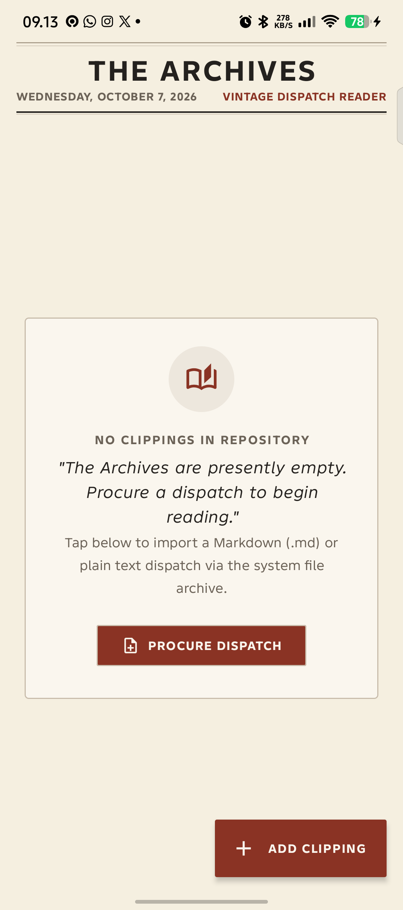

# 📜 Tinta — Vintage Editorial Markdown Reader

<p align="center">
  
</p>

<p align="center">
  <em>An elegant, distraction-free Android Markdown reader that treats your digital dispatches like timeless print journalism.</em>
</p>

<p align="center">
  <a href="https://github.com/mzhafraan/Tinta-md-reader/releases/latest"></a>
  
  
  
  
  <a href="LICENSE"></a>
</p>

---

## ☕ Why Tinta?

Most mobile Markdown readers suffer from the **"Cold Developer Aesthetic"**: stark pure-black dark modes, high-contrast neon highlights, and cramped monospaced fonts that cause severe visual fatigue when reading long-form technical reports, architecture RFCs, academic papers, or AI agent transcripts.

**Tinta** reimagines digital reading through the lens of **classic print journalism**:
* **Warm Parchment Comfort**: Curated warm paper tones (`#F7F4EB`) and soft editorial ink (`#1F1D1A`) engineered to eliminate eye strain during 30+ minute reading sessions.
* **Typographic Craftsmanship**: Editorial serif headings, balanced line-heights, and authentic physical newspaper ornament dividers.
* **Absolute Zero-Trust Privacy**: Zero analytics, zero tracking, and **zero network permissions** (`android.permission.INTERNET` is non-existent). Your dispatches never touch any external server.

---

## ✨ Key Features

### 📰 The Gazette Reader
* **Fluid Markdown Rendering**: Support for Headings (H1–H6), rich formatting (bold, italic, strikethrough), blockquotes, bullet/numbered lists, and horizontal dividers.
* **Typewriter Code Blocks**: Code snippets rendered in vintage monospaced typewriters with syntax padding and a **one-tap instant clipboard copy** button.
* **Reading Analytics**: Dynamic word count, estimated reading time, and clean snippet extraction.

### 🗄️ The Archives
* **Persistent Document Drawer**: Powered by Android's **Storage Access Framework (SAF)** with persistable URI retention—pick your document once, and re-open it anytime without annoying system file-picker prompts.
* **Instant Dispatches**: Fast retrieval of your most recently consulted `.md` and `.txt` files with automated preview snippets and timestamps.
* **Safe Eviction**: Remove entries from your reading archive at any time without deleting the underlying physical file on your device.

### 🛡️ Privacy & Performance
* **100% Offline by Design**: Verified zero network permissions in `AndroidManifest.xml`.
* **Zero Bloat, Zero Telemetry**: Lightweight footprint, snappy cold-start ($\le 1.0\text{s}$), and smooth 60/120fps scrolling.

---

## 📱 Quick Download

Get the latest build directly on your Android phone (no Google Play account required):

👉 **[Download Latest APK from GitHub Releases](https://github.com/mzhafraan/Tinta-md-reader/releases/latest)**

> **Note:** Since this APK is distributed directly outside the Google Play Store, Android will display a standard *"Install unknown apps"* prompt. Grant permission for your browser or file manager to proceed with the installation.

---

## 🏗️ Architecture & Tech Stack

Tinta is built following modern **Android Clean Architecture** principles paired with **MVVM (Model-View-ViewModel)** and **Unidirectional Data Flow (UDF)**:

```
app/src/main/java/com/zeeonworks/tinta/
├── data/
│   ├── model/           # Data definitions (DocumentArchive metadata)
│   ├── repository/      # SAF content resolver & safe InputStream readers
│   └── preferences/     # Jetpack DataStore for persistent recent archives
├── ui/
│   ├── archives/        # The Archives screen & dispatch cards
│   ├── reader/          # The Gazette reading canvas & typewriter code blocks
│   ├── navigation/      # Jetpack Compose Navigation Graph
│   └── theme/           # Warm parchment color system & vintage typography
└── MainActivity.kt      # Single-activity Compose container
```

* **Language**: [Kotlin](https://kotlinlang.org/) (Coroutines + Flow)
* **UI Toolkit**: [Jetpack Compose](https://developer.android.com/jetpack/compose) with Material 3 integration
* **Parser Engine**: [CommonMark Java](https://github.com/commonmark/commonmark-java) for RFC-compliant AST Markdown parsing
* **Local Persistence**: [Android Jetpack DataStore](https://developer.android.com/topic/libraries/architecture/datastore) (Preferences + Kotlinx Serialization)
* **Storage Interface**: Android Storage Access Framework (`ActivityResultContracts.OpenDocument`)

---

## 🛠️ Building from Source

### Prerequisites
* **Android Studio**: Ladybug (2024.2.1+) or newer
* **JDK**: Version 17
* **Android SDK**: Min SDK 26 (Android 8.0 Oreo), Target SDK 34+

### Clone & Compile
```bash
# 1. Clone this repository
git clone https://github.com/mzhafraan/Tinta-md-reader.git

# 2. Enter the project root
cd Tinta-md-reader

# 3. Build debug APK
./gradlew assembleDebug

# 4. Run unit tests
./gradlew test
```

The compiled APK will be located at `app/build/outputs/apk/debug/app-debug.apk`.

---

## 🗺️ Roadmap

- [x] **v1.0 (MVP Gazette)**: Core Markdown reader, SAF persistable URI, The Archives grid, typewriter code blocks.
- [ ] **v1.1 (Editorial Polish)**:
  - Reading customization: Font size slider, font family switcher (*Serif*, *Sans*, *Mono*).
  - Paper tint options (*Morning Gazette*, *Aged Parchment*, *Midnight Sepia*).
- [ ] **v1.2 (Document Navigation)**:
  - Table of Contents (TOC) drawer generated from markdown headings.
  - Search within document text.
- [ ] **v1.3 (Extended Markdown)**:
  - GFM Tables (`| Col |`) rendering.
  - Task checkboxes (`- [x]`).
  - Offline math equations ($LaTeX$) preview.
- [ ] **v1.4 (Archival Export)**:
  - Export document to styled Vintage Editorial PDF format.

---

## 🤝 Contributing

Contributions, feature suggestions, and bug reports are warmly welcome!
1. Read our [Contributing Guide](CONTRIBUTING.md) for code style and PR guidelines.
2. Check existing [Issues](https://github.com/mzhafraan/Tinta-md-reader/issues) or open a new one.
3. Fork the repository, create a branch (`feature/your-feature`), and open a Pull Request.

---

## 📜 License

Tinta is open-source software licensed under the **[Apache License 2.0](LICENSE)**.

---

<p align="center">
  Crafted with care by <strong><a href="https://github.com/mzhafraan">M Zhafran</a></strong> &bull; <em>Keep the printing press rolling.</em>
</p>
